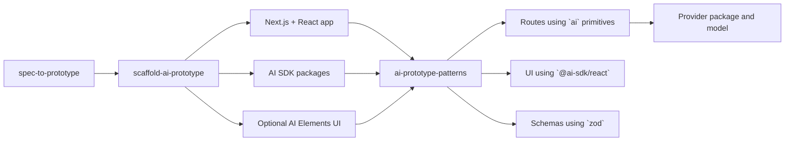

# codex-prototype-skills

Forkable Codex skill starter for rapidly prototyping AI apps.

This repo is meant to be copied, forked, and adapted. It gives you a small starter set of Codex-specific skills plus helper scripts so you can go from idea to working prototype quickly.

The core loop is:

`idea -> spec -> scaffold -> implement`

## Why This Repo Exists

This repo gives you a practical starting point for Codex App workflows:

- fork it to create your own skill repo
- use the included Python scripts to create a new prototype subfolder or repo with the right starter skills installed
- start from a chat prompt or drop in an `idea.md` file and use `spec-to-prototype` to shape the first spec
- iterate on the spec until it is strong enough to build
- use the scaffold and implementation skills to turn that spec into a prototype

If you like, pair this with Codex plan mode to build the spec and implementation plan together before writing code.

## What You Get

This repository is the source of truth for a small Codex skill chain:

1. `spec-to-prototype`
   Turns a rough idea into an execution-ready `SPEC.md` with scope, work packages, dependency order, and binary success criteria.
2. `scaffold-ai-prototype`
   Scaffolds a Next.js + AI SDK starter that matches the selected prototype pattern.
3. `ai-prototype-patterns`
   Implements or extends the product using the right AI SDK interaction pattern.
4. `refresh-ai-sdk-skills`
   Helps maintain this skill repo against upstream AI SDK, AI Elements, and shadcn/ui changes.

These are not generic prompts. They are intended for Codex App and Codex skill workflows.

## Recommended Workflow

```text
Fork this repo
  ->
Create a prototype folder or repo with the helper script
  ->
Install the core skills into .codex/skills/
  ->
Start with an idea in chat or idea.md
  ->
Use spec-to-prototype to create and refine SPEC.md
  ->
Use scaffold-ai-prototype to generate the starter
  ->
Use ai-prototype-patterns to implement the product
  ->
Repeat until the prototype is ready
```



```mermaid
flowchart LR
    A["Fork this repo"] --> B["Create a prototype repo or subfolder"]
    B --> C["Install core Codex skills with the Python scripts"]
    C --> D["Start from chat or idea.md"]
    D --> E["spec-to-prototype<br/>create and refine SPEC.md"]
    E --> F["scaffold-ai-prototype<br/>generate the starter"]
    F --> G["ai-prototype-patterns<br/>implement the prototype"]
    G --> H["Iterate with Codex chat or plan mode"]
    H --> I["Add your own skills, or open a PR / issue"]
```

## Who It Is For

Use this repo if you:

- build AI prototypes regularly
- use the Codex App or another Codex-compatible local skill workflow
- want a reusable starter set instead of rebuilding your prototyping process every time
- want a repo you can fork and extend with your own Codex skills

## Quick Start

Prerequisites:

- Python 3.10+
- Git if you want the helper script to initialize repos
- Codex App or another environment that can use local Codex skills

Create a fresh prototype repo:

```bash
python3 scripts/prototype_create.py ../prototypes/my-idea
```

Install skills into an existing repo:

```bash
python3 scripts/prototype_init.py ../prototypes/my-idea
```

Then in the target repo:

1. start a Codex chat with your idea, or add an `idea.md`
2. use `spec-to-prototype` to generate `SPEC.md`
3. iterate on the spec until the scope and plan are clear
4. use `scaffold-ai-prototype`
5. use `ai-prototype-patterns`

## Skill Summary

| Skill | Purpose | Typical output |
| --- | --- | --- |
| `spec-to-prototype` | Product/spec shaping | `SPEC.md` with scope, work packages, and success criteria |
| `scaffold-ai-prototype` | Starter generation | Pattern-aligned Next.js + AI SDK scaffold |
| `ai-prototype-patterns` | Feature implementation | Concrete code changes for the chosen interaction pattern |
| `refresh-ai-sdk-skills` | Repo maintenance | Drift review and updates for this skill system |

The shared pattern vocabulary is:

- `chat`
- `tool-calling-chat`
- `generative-ui`
- `structured-generation`
- `server-workflow`
- `agent-loop`
- `voice`

## Open-Source Stack Behind The Skills

The skills in this repo are designed to work with a small, practical open-source stack for AI prototypes:

- `next`: app shell, routing, API handlers, and build pipeline
- `react`: interactive UI
- `ai`: core AI SDK server primitives such as `streamText`, `generateText`, `tool()`, and `Output.object()`
- `@ai-sdk/react`: client hooks such as `useChat` and `experimental_useObject`
- `zod`: shared typed contracts for structured outputs and tool inputs
- `ai-elements`: optional UI building blocks for chat, tool, reasoning, confirmation, and speech flows
- `@ai-sdk/gateway`: default provider path
- `@ai-sdk/google`, `@ai-sdk/anthropic`, `@ai-sdk/openai`, `@ai-sdk/groq`: optional provider packages depending on the prototype

In practice, the skills use those packages together like this:



That is the main reason this repo works well as a starter: the skills are not isolated prompts, they are a coordinated system built around a shared package stack and shared implementation patterns.

## Extend It

This repo is designed to be extended.

You can:

- add your own Codex skills in your fork
- keep private team-specific skills in your forked copy
- open issues to request new skills or workflow improvements
- submit PRs if you want to improve the shared starter set

The best default is usually:

- keep this repo or your fork as the skill source of truth
- create separate prototype repos as needed
- install only the skills each prototype actually needs

## Scripts

- `scripts/prototype_create.py`: create a new prototype repo and install skills
- `scripts/prototype_init.py`: install, link, or refresh skills in an existing repo
- `scripts/validate_skills.py`: validate the skills, docs, and required release files
- `scripts/export_open_source_repo.py`: create a clean publishable copy of the repo

Script docs:

- [`docs/prototype-create.md`](docs/prototype-create.md)
- [`docs/prototype-init.md`](docs/prototype-init.md)
- [`docs/rapid-prototyping-setup.md`](docs/rapid-prototyping-setup.md)
- [`docs/export-open-source.md`](docs/export-open-source.md)

## Validate The Repo

Run:

```bash
python3 scripts/validate_skills.py
```

Recommended verification:

```bash
python3 scripts/validate_skills.py
python3 scripts/prototype_create.py /tmp/codex-prototype-create-test --force
python3 scripts/prototype_init.py /tmp/codex-prototype-create-test --mode sync --skills core
```

## Limitations

- The skills are intentionally opinionated.
- They are optimized for Codex workflows, not every agent runtime.
- They help bootstrap prototypes quickly, but downstream app quality still depends on implementation and review.
- Upstream AI SDK and AI Elements APIs can drift, so maintenance still matters.
